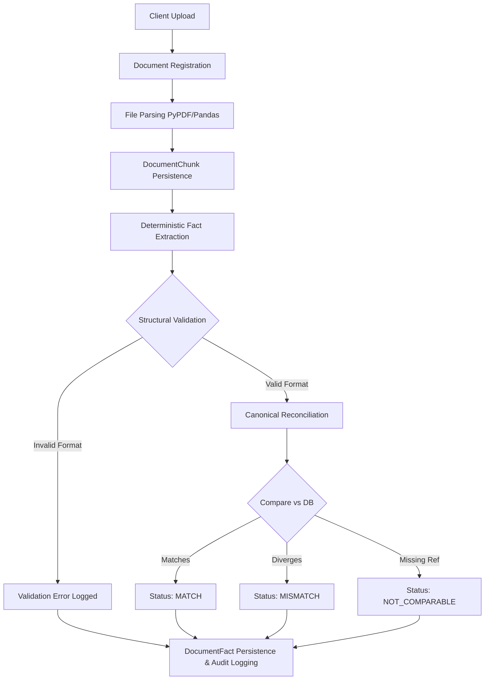

# Document Intelligence V1

InfraPM Intelligence includes a robust Document Intelligence V1 feature focused on deterministic extraction and reconciliation of structured business facts from PDF and XLSX evidence.

## Architecture & Data Flow

## Capabilities

The current V1 implementation provides deterministic extraction for:
- **Contract Summaries** (PDF)
- **Bill of Quantities (BOQ)** (XLSX)
- **Measurement Books** (XLSX)
- **RA Bills** (XLSX)
- **Earned Value Management (EVM)** Progress Reports (PDF)

## Source Validation vs. Canonical Reconciliation

The extraction service strictly separates data validation from canonical reconciliation. A successful extraction result is *not* described as "correct" merely because it parses successfully.

1. **Validation**: The parser verifies structural integrity (e.g., proper decimals, absence of excessive precision, handling of duplicate observations). Invalid or ambiguous metrics (such as negative costs or overlapping fields) are flagged with `VALIDATION_ERRORS`, meaning the facts are structurally `INVALID`. Syntactic validity does not guarantee business accuracy.
2. **Reconciliation**: Structurally valid facts are dynamically cross-referenced against authoritative canonical data. 
   - `MATCH`: Source evidence matches canonical calculations exactly.
   - `MISMATCH`: Source evidence diverges from canonical calculations.
   - `NOT_COMPARABLE`: Missing critical context preventing comparison.

### Canonical EVM Calculation Rules
The canonical EVM baseline operates mathematically independently from uploaded PDFs:
- **PV (Planned Value)**: Derived from the approved EVM baseline schedule.
- **EV (Earned Value)**: Derived from approved physical measurements valued at canonical BOQ rates.
- **AC (Actual Cost)**: Calculated as the cumulative value of approved RA Bills with a `bill_date` on or before the checkpoint date.

**Important Note**: Discrepancies between the PDF and canonical data (such as synthetic mismatch tests) are *never* silently corrected. They are recorded accurately as `MISMATCH` events.

## Integrity & Resilience

- **Provenance**: Extracted facts are tied immutably to the underlying `DocumentChunk` (page/row) and `Document` via foreign keys, tracing every number back to its exact location in the source file.
- **Idempotency**: Re-running extraction over the same document safely bypasses duplicates. The UUIDs of the facts are preserved without creating redundant facts or `AuditLog` records.
- **Transactional Rollback**: The entire intelligence extraction operates inside a single database transaction. A failure instantly triggers a rollback, guaranteeing no partial or malformed `DocumentFact` saves.

## What is NOT Yet Supported
- Non-deterministic or unstructured document extraction (e.g., LLMs/RAG).
- Scanned PDF OCR.
- Row-level or Project-level Data Access Isolation (current RBAC roles are system-global).
- Automatic database updates based on extracted metrics (intelligence evaluates evidence; it does not mutate canonical project records).
