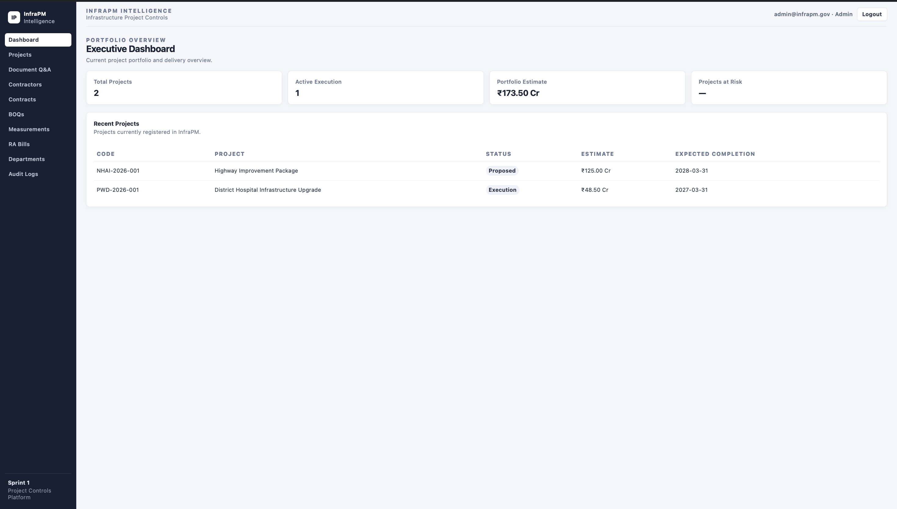
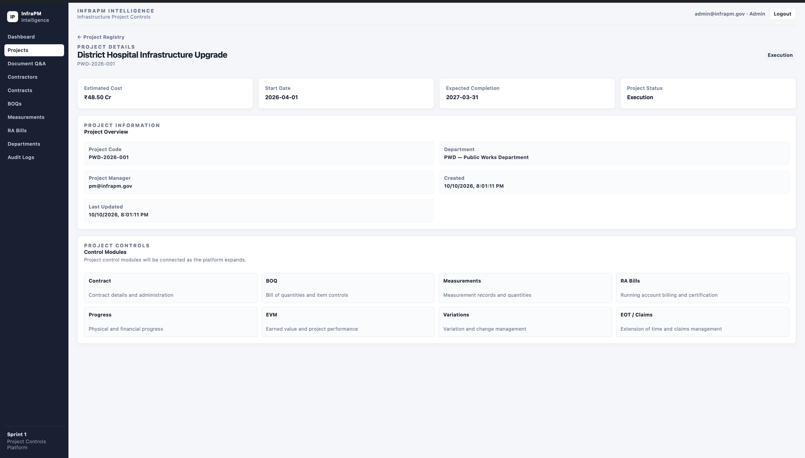
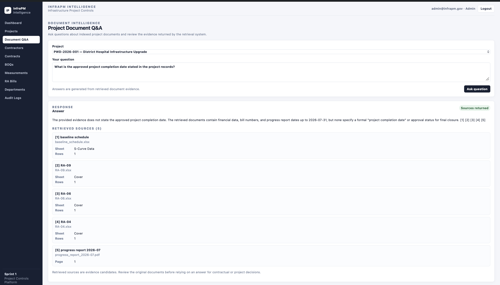

# InfraPM Intelligence

**Infrastructure Project Controls & AI-Assisted Document Intelligence**

InfraPM Intelligence is an independent portfolio project exploring how construction project controls, contract administration, and document-based question answering can be integrated into one application.

The platform combines deterministic project-control calculations with document retrieval and LLM-assisted responses grounded in retrieved evidence.

## Overview

Construction projects generate structured data across contracts, Bills of Quantities (BOQs), measurements, billing records, schedules, and project documents. InfraPM Intelligence provides a foundation for managing these workflows and exploring how document intelligence can support project teams.

### Target Users

- Project Managers
- Billing Engineers and Quantity Surveyors
- Site Engineers
- Infrastructure project administrators

## Key Capabilities

- **Authentication and RBAC:** JWT authentication and role-based access control.
- **Core Registries:** Project, department, and contractor management.
- **Contracts and BOQ:** Contract definitions, Bills of Quantities, and revision tracking.
- **Measurements and RA Billing:** Physical execution tracking and billing workflows.
- **Extension of Time (EOT):** Application, submission, review, approval, and rejection workflows.
- **Earned Value Management (EVM):** Planned Value (PV), Earned Value (EV), and Actual Cost (AC) metrics.
- **Document Intelligence:** Document parsing, structured extraction, validation, and reconciliation.
- **Document Q&A with RAG:** Embeddings, similarity-based retrieval, project-scoped retrieval logic, source metadata, citation-reference validation, and insufficient-evidence handling.

## Application Screenshots

### Executive Dashboard

<!-- Add a genuine application screenshot at docs/assets/dashboard.png -->



### Project Details

<!-- Add a genuine application screenshot at docs/assets/project-details.png -->



### Document Q&A

<!-- Add a genuine application screenshot at docs/assets/document-qa.png -->



## Technology Stack

| Layer              | Technologies                                                         |
| ------------------ | -------------------------------------------------------------------- |
| Backend            | Python, FastAPI                                                      |
| ORM and migrations | SQLAlchemy, Alembic                                                  |
| Database           | PostgreSQL, pgvector                                                 |
| Frontend           | React, TypeScript, Vite                                              |
| AI and retrieval   | Ollama-based embeddings and LLM generation, vector similarity search |
| Testing            | Pytest, frontend production build                                    |

## Architecture

```text
React + TypeScript Frontend
            |
            v
      FastAPI REST API
            |
            v
       Service Layer
            |
            v
 SQLAlchemy + PostgreSQL
            |
            v
       pgvector Search
```

The document Q&A workflow processes documents, generates embeddings, retrieves relevant content, and supplies retrieved evidence to an LLM to generate a contextual response.

Project-control calculations and AI-generated explanations serve different purposes: calculated project metrics should be derived from structured data and deterministic business logic, while document Q&A helps users locate and interpret information contained in project records.

See [docs/architecture.md](docs/architecture.md) for the detailed architecture.

## Quick Start

### Prerequisites

- Docker Desktop or OrbStack
- Git

### Start the Application

Clone the repository and enter the project directory:

```bash
git clone https://github.com/rb-ananth/infra-pm.git
cd infra-pm
```

Start the services:

```bash
docker compose up -d
```

The application exposes the following local endpoints:

- **Frontend:** http://localhost:5173
- **Backend API documentation:** http://localhost:8000/docs

Follow the repository's environment configuration, database migration, and setup instructions before using the application.

> **Important:** Do not run the seed script against an existing populated database without reviewing its behavior. It provisions fixed canonical IDs and may conflict with existing records.

## Testing and Verification

The latest recorded development-environment verification included:

| Test suite                | Recorded result                      |
| ------------------------- | ------------------------------------ |
| Backend regression suite  | 175 passed, 1 skipped, 20 deselected |
| Golden-dataset suite      | 20 passed                            |
| Focused EOT and RAG suite | 29 passed                            |
| Frontend production build | Passed                               |

These are recorded development results, not evidence of production deployment or independent validation. Test results should be rerun against the current repository state before being treated as current.

## Known Limitations

- Project-level authorization and data isolation require further security review before production use.
- Citation-reference validation does not independently prove that every generated claim is entailed by its cited source.
- Retrieval relevance and answer quality require broader evaluation on representative project documents.
- Document extraction behavior depends on source-document structure and implemented parsing rules.
- Production deployment, monitoring, backup and restoration, and operational recovery have not been fully validated.

## Roadmap

- Evaluate retrieval relevance and grounded-answer quality on representative documents.
- Expand project-level authorization and security testing.
- Develop and validate predictive cost and schedule risk models.
- Improve operational observability and deployment readiness.

## Project Status

InfraPM Intelligence is an evolving independent portfolio project demonstrating the integration of infrastructure project controls, backend API development, structured data management, and AI-assisted document retrieval.

It is intended for technical demonstration and continued development, not presented as a production-validated platform.
