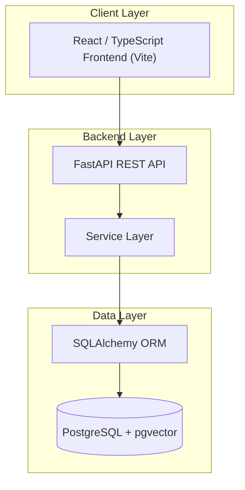
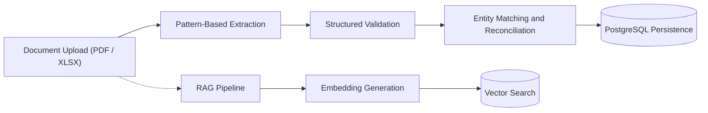
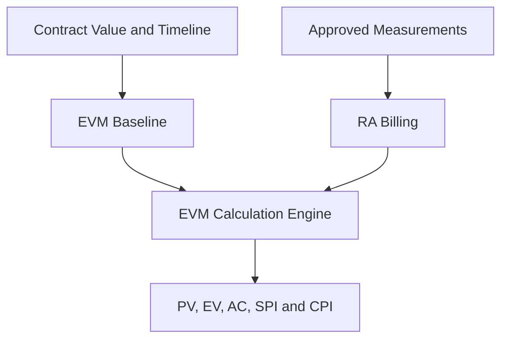

# InfraPM Intelligence Architecture

## High-Level System Architecture

## Document Intelligence & Ingestion Flow

The current platform implements a deterministic ingestion and reconciliation pipeline for core documents (Contracts, BOQs, Measurements, RA Bills).

## Earned Value Management (EVM) Flow

